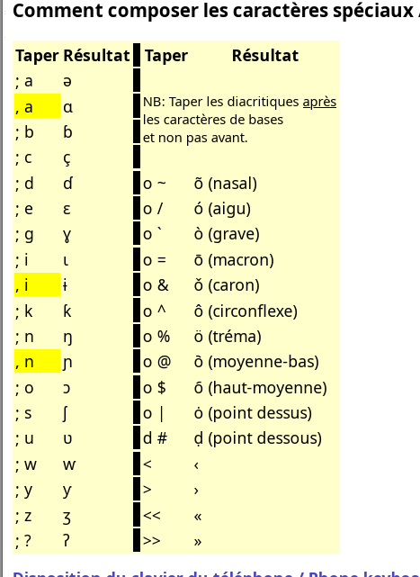

Mooré uses letters that are not on a French keyboard: **ɛ, ɩ, ʋ** and nasal vowels like **ã, ẽ, ũ**. The usual answer is to install [Keyman](https://keyman.com) and the *Clavier du Burkina* keyboard from SIL Burkina Faso. On Windows, that works well. On Linux with an AZERTY keyboard, it does not.

## The problem: Keyman switches you to QWERTY

I installed Keyman and *Clavier du Burkina* on Ubuntu (GNOME). My keyboard is AZERTY, but my system language is English. As soon as I switched to the Keyman keyboard, typing the key labelled **A** gave `q`, and **Z** gave `w`. The layout was QWERTY.

The system language is not the cause. Every Keyman keyboard registered in IBus declares a US layout:

```bash
python3 -c "
import gi; gi.require_version('IBus', '1.0'); from gi.repository import IBus
for e in IBus.Bus().list_engines():
    if 'keyman' in e.get_name():
        print(e.get_name(), e.get_layout())
"
# mos:/home/.../clavbur9/clavbur9.kmx us
```

When you activate the engine, GNOME switches the keyboard to `us`. On my machine, `setxkbmap -query` showed `layout: fr,us,us`. Keyman for Linux also reads keys by their position on a US keyboard, and Keyman 18 has no setting to use a different base layout.

So on Linux, *Clavier du Burkina* only works if you type as if on QWERTY.

## The fix: the French (Togo) layout

Linux already includes a keyboard layout for this: **French (Togo)** (`tg` in XKB). It is standard French AZERTY with West African letters added on **AltGr** (the right Alt key). No Keyman needed.

To add it:

1. Open **Settings → Keyboard**.
2. Under **Input Sources**, click **+ Add Input Source**.
3. Choose **French → French (Togo)**. If it isn't listed, click **⋮** and search for "Togo".
4. Press **Super + Space** to switch between layouts.

Or from a terminal:

```bash
gsettings set org.gnome.desktop.input-sources sources "[('xkb', 'fr'), ('xkb', 'tg')]"
```

## Typing the Mooré letters

| Letter | Keys |
|---|---|
| ɛ / Ɛ | AltGr + r / AltGr + Shift + r |
| ɩ / Ɩ | AltGr + i / AltGr + Shift + i |
| ʋ / Ʋ | AltGr + v / AltGr + Shift + v |
| ã | AltGr + !, then a |
| ẽ | AltGr + !, then e |
| ũ | AltGr + !, then u |

**AltGr + !** is a *dead key*: nothing appears when you press it, and the tilde goes on the next letter you type. Press the tilde **first**, then the vowel. This works with capitals too (Ã, Ẽ, Ũ) and with ɛ and ɔ (ɛ̃, ɔ̃).

The layout also has other letters used in the region:

| Letter | Keys |
|---|---|
| ɔ | AltGr + o |
| ŋ | AltGr + n |
| ɲ | AltGr + m |
| ɓ | AltGr + b |
| ɗ | AltGr + t |
| ƴ | AltGr + y |
| ɣ | AltGr + g |

Tone marks are dead keys as well: acute **AltGr + \***, grave **AltGr + ù**, macron **AltGr + :** and caron **AltGr + ^**.

## Windows

You can download the Windows version of Keyman from [keyman.com/windows/download](https://keyman.com/en/windows/download).
The [Clavier du Burkina](https://keyman.com/en/keyboards/clavbur9?bcp47=mos#expand-languages) keyboard (`clavbur9`) works well if you already type on a French AZERTY layout. It keeps the familiar AZERTY keys and adds Mooré letters, along with characters for other languages of Burkina Faso, as shown below:



## Summary

- On Linux, Keyman keyboards use a US QWERTY base, whatever your physical keyboard is.
- If you type on AZERTY, use the built-in **French (Togo)** layout.
- ɛ, ɩ, ʋ are on AltGr + r, i, v, and nasal vowels are **AltGr + !** followed by the vowel.
- On Windows, *Clavier du Burkina* works well with a French AZERTY layout.
